

# 🔌 PCB Tasarımları ve 3B Baskı Parçaları

**Altium Designer ile şemasını ve baskı devresini tasarladığım mikrodenetleyici kartları, sensör modülleri, güç ve motor sürücü kartları, ayrıca projelerim için tasarladığım 3B baskı parçaları**

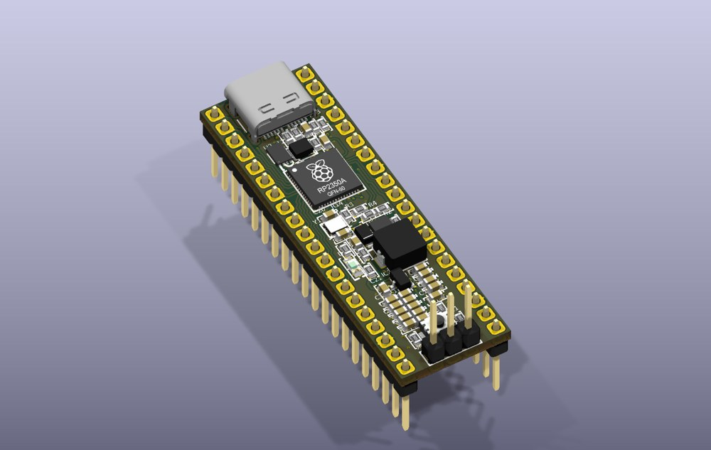

## Geliştirme kartları

<table>
<tr>
<td width="50%" valign="top"> 
<b>RP2350 geliştirme kartı (Pico 2 uyumlu)</b> 
RP2350A, W25Q32 QSPI flash, RT6150B buck-boost 3,3 V regülatör, USB-C, BOOT/RESET düğmeleri, SWD başlığı, Pico pin düzeni.
</td>
<td width="50%" valign="top">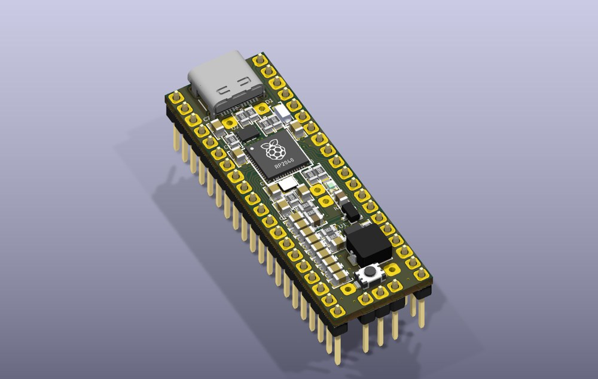 
<b>RP2040 geliştirme kartı</b> 
RP2040, W25Q16 flash, RT6150B regülatör, USB-C, güç yolu koruması (Schottky + P-MOSFET), Pico pin düzeni.
</td>
</tr>
<tr>
<td width="50%" valign="top">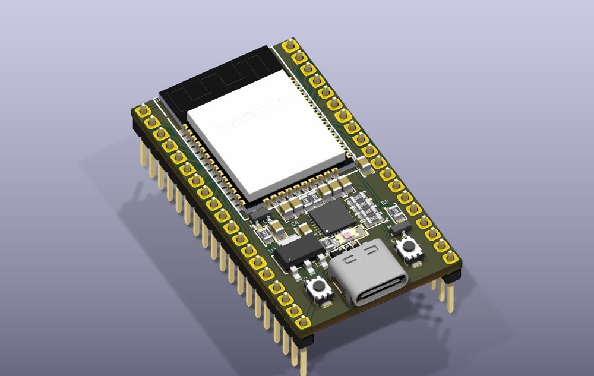 
<b>ESP32 geliştirme kartı</b> 
ESP32-WROOM-32, CP2102N USB-UART, otomatik programlama devresi (transistörlü EN/IO0), AMS1117 3,3 V, USB-C ve ESD koruması.
</td>
<td width="50%" valign="top">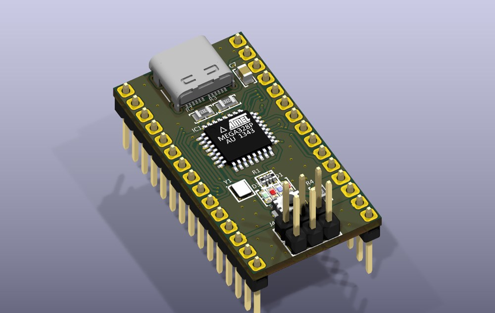 
<b>ATmega328P kartı (Nano uyumlu)</b> 
ATmega328P, FT232RL USB-UART, 78M05 regülatör, USB-C, durum LED'leri, ICSP başlığı.
</td>
</tr>
</table>

## Modüller ve güç kartları

| | | |
|---|---|---|
| 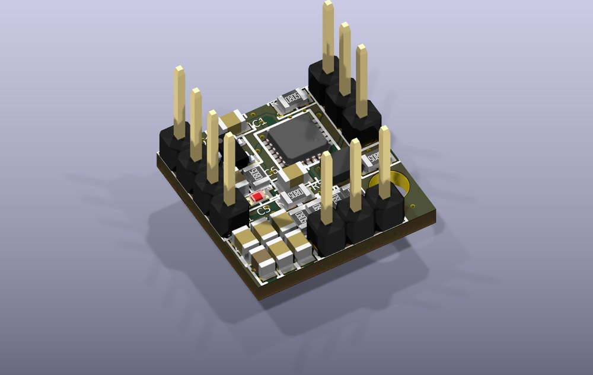 **IMU + barometre modülü** MPU6050 + BMP280, LD3985 LDO; uçuş bilgisayarları için tek modül | 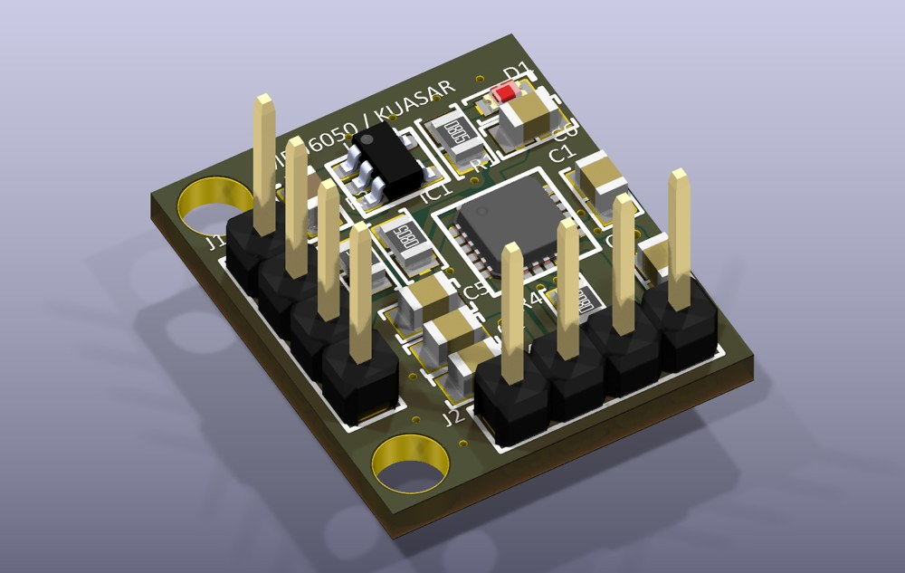 **MPU6050 modülü** 6 eksen IMU, LDO, montaj delikli | 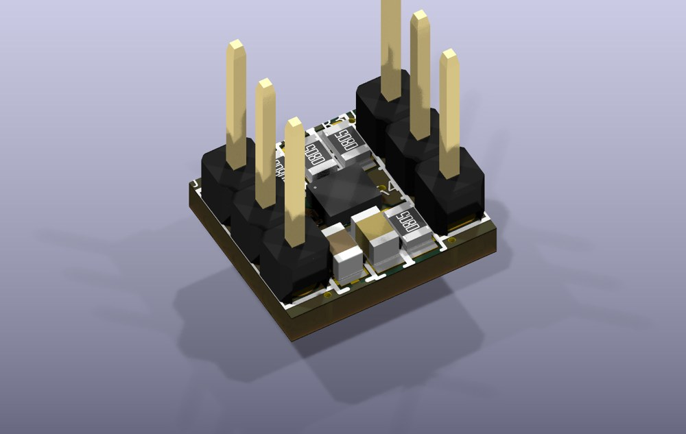 **BMP280 modülü** Basınç/irtifa sensörü, I2C/SPI |
| 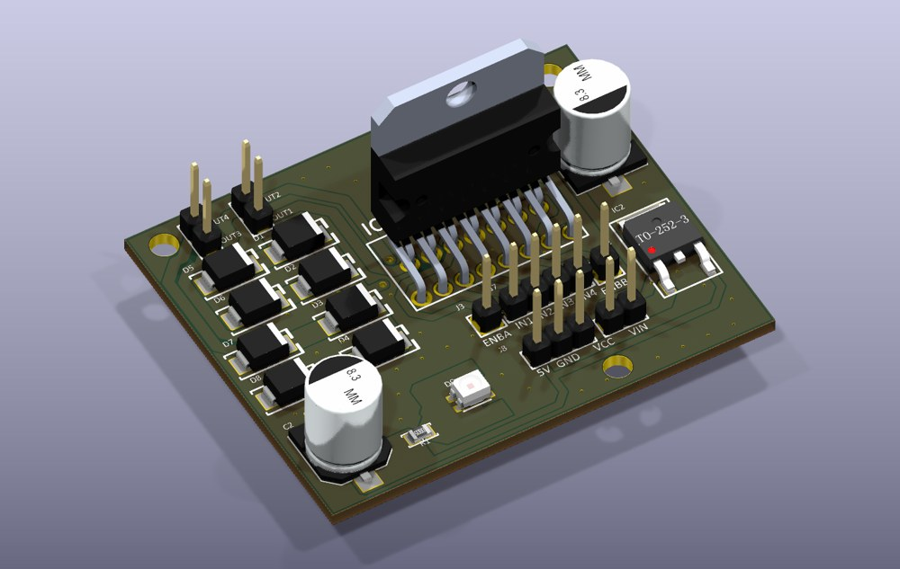 **L298N motor sürücü** Çift H-köprü, flyback diyotları, 78M05 lojik beslemesi | 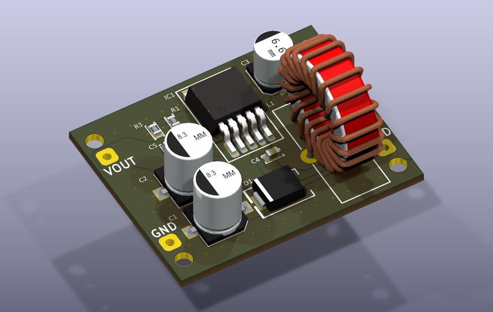 **LM2587 boost dönüştürücü** Yükseltici DC-DC, Schottky diyot, giriş/çıkış filtreleri | 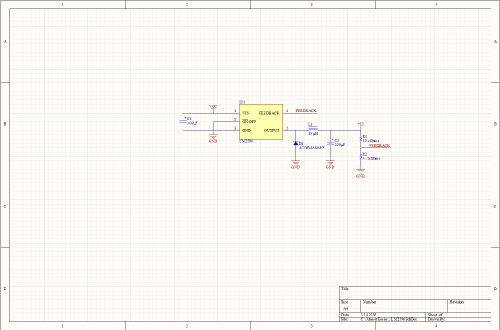 **LM2596 buck dönüştürücü** Düşürücü DC-DC (şema) |

> Görseller Altium kart dosyalarından KiCad 3B görüntüleyicisiyle render edilmiştir. Şema önizlemeleri [`docs/schematics`](docs/schematics) klasöründedir.

## 3B baskı parçaları
Drone, RC araç ve robot projelerim için tasarlayıp FDM yazıcıda bastığım parçalardan bazıları (STL/G-code dosyalarından render):

| | | |
|---|---|---|
| 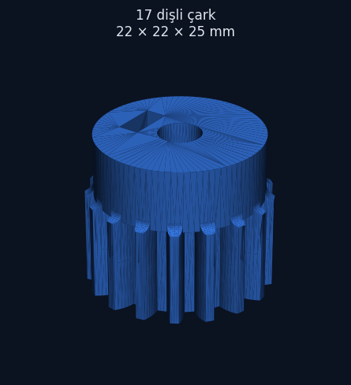 17 dişli çark | 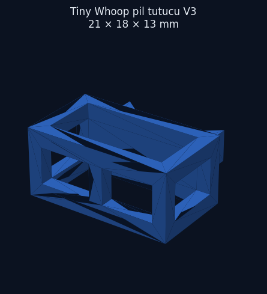 Tiny Whoop pil tutucu | 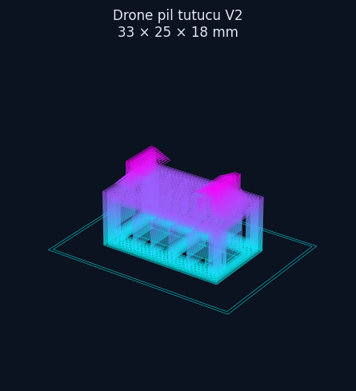 Drone pil tutucu |
| 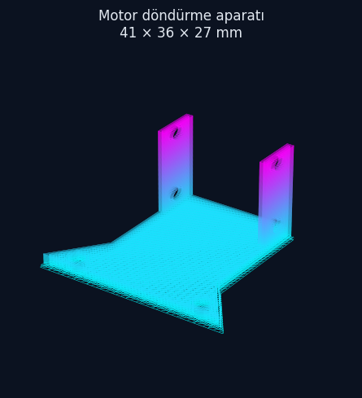 Motor döndürme aparatı | 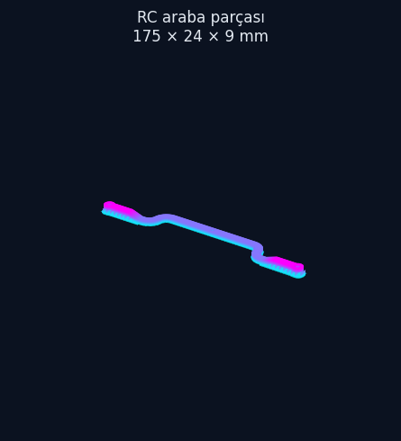 RC araç parçası | |

## Neler öğrendim
- Mikrodenetleyici kartı tasarımı: kristal ve flash yerleşimi, USB diferansiyel hatları, güç yolu koruması, programlama devreleri.
- Anahtarlamalı güç kaynaklarında (buck/boost) bileşen seçimi ve yerleşimi.
- Kendi kartlarımı ve parçalarımı robot projelerinde kullanarak tasarım–üretim–test döngüsü.

---
© Ahmet Emin Arslanbaş — Tüm hakları saklıdır. Tasarım dosyaları paylaşılmamıştır.
